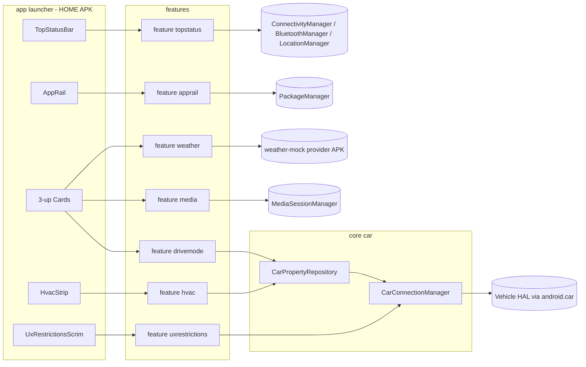

# Toyota Multimedia – Android Automotive Launcher

A Jetpack Compose Android Automotive (AAOS) launcher that recreates the
Toyota multimedia head-unit dashboard: left app rail, three center cards
(Drive Mode, Weather, Now Playing), top status strip, and an interactive
HVAC strip wired to the real Vehicle HAL via `CarPropertyManager`.

Built as an interview portfolio piece for AAOS-focused vehicle software
roles. The thing it actually demonstrates beyond visuals is the AAOS
*integration* surface: privileged-app installation, Car API lifecycle,
`callbackFlow` bridging from the VHAL into Compose state, and driver
distraction handling via `CarUxRestrictionsManager`.

## Reference UI

The dashboard is modeled after the in-car screen below:

- Top status bar with notification bell, brand pill, signal/carrier, BT,
  mic, location, clock
- Left app rail (Home, Nav, Music, Phone, Settings)
- Three primary cards: Drive Mode (brown), Weather (blue), FM/Now Playing (green)
- Bottom HVAC strip with driver/passenger temp, seat heat, defrost, AUTO, fan, sync

## Architecture



### Module layout

| Module                     | Type    | Purpose                                                                   |
|----------------------------|---------|---------------------------------------------------------------------------|
| `:app:launcher`            | apk     | HOME activity, immersive window, Hilt entry point, top-level composition  |
| `:core:car`                | lib     | `CarConnectionManager` + `CarPropertyRepository` Flow wrapper             |
| `:core:design`             | lib     | Toyota-flavored Material3 theme, `BigCard`, `LocalSpacing`                |
| `:feature:hvac`            | lib     | HVAC repo + ViewModel + `HvacStrip` composable                            |
| `:feature:drivemode`       | lib     | Gear + drive-mode card                                                    |
| `:feature:media`           | lib     | MediaSession-driven Now Playing card                                      |
| `:feature:weather`         | lib     | Weather card backed by mock ContentProvider                               |
| `:feature:apprail`         | lib     | Left rail (Home/Nav/Music/Phone/Settings)                                 |
| `:feature:topstatus`       | lib     | Top status strip (clock, connectivity, BT, mic, location)                 |
| `:feature:uxrestrictions`  | lib     | `CarUxRestrictionsManager` observer + driving banner                      |
| `:provider:weather-mock`   | apk     | Sibling APK exposing `content://com.toyota.weather/current`               |

## Build environment

- Android Studio Iguana / Hedgehog or newer
- AGP 8.5.2, Kotlin 1.9.24, JVM 17
- `compileSdk = 34`, `minSdk = 33`
- Gradle 8.7 (configured in [gradle/wrapper/gradle-wrapper.properties](gradle/wrapper/gradle-wrapper.properties))

The first time you check out, generate the wrapper:

```bash
cd toyota-launcher
gradle wrapper
```

After that:

```bash
./gradlew :app:launcher:assembleDebug
./gradlew :provider:weather-mock:assembleDebug
```

## Running on an AAOS emulator

You need a *userdebug* AAOS image (the `playstore` variant disallows
`adb root` which is required for the privileged-app install).

```bash
./tools/scripts/start-emulator.sh
```

This will:

1. `sdkmanager --install "system-images;android-34;android-automotive;x86_64"`
2. Create AVD `aaos_toyota` with the `automotive_1024p_landscape` profile
3. Boot the emulator with `-writable-system`
4. Wait for `sys.boot_completed`

Once it's up, install the launcher as a privileged app:

```bash
./tools/scripts/install-priv.sh
```

That script:

1. `adb root && adb remount`
2. Pushes the launcher APK to `/system/priv-app/ToyotaLauncher/`
3. Pushes a privapp allowlist XML to `/etc/permissions/`
4. Installs the weather mock APK
5. Reboots
6. Sets the Toyota launcher as HOME via `cmd package set-home-activity`

Verify privileged permissions are granted:

```bash
adb shell dumpsys package com.toyota.launcher | grep -E 'granted=true|priv-app'
```

## Driving the HVAC properties on the emulator

The AAOS emulator ships a fake VHAL. Inject HVAC changes from the host:

```bash
# Set driver-side temp to 22 C
adb shell cmd car_service inject-vhal-event 0x05000000 22.0 -a 4

# Set fan speed to 5
adb shell cmd car_service inject-vhal-event 0x06000000 5

# Toggle AC on
adb shell cmd car_service inject-vhal-event 0x07000000 true

# Move the gear lever to D (0x0008)
adb shell cmd car_service inject-vhal-event 0x05000400 8
```

The HVAC strip and Drive Mode card will react in real time because their
flows are subscribed to the same VHAL change events.

## What to talk about in the interview

A short tour through the design choices that demonstrate AAOS depth:

1. **HOME takeover vs. SystemUI replacement.**
   The Toyota reference shows top + bottom strips that production OEMs
   own through a custom `CarSystemUI` APK. We chose immersive HOME
   takeover instead — same visual, ~10x less work, no system_server
   integration. Discuss the trade-off (custom SystemUI is the right call
   for shipping product, immersive launcher is the right call for a
   demo).
2. **Privileged permission flow.**
   `MEDIA_CONTENT_CONTROL`, `CONTROL_CAR_CLIMATE`, etc. cannot be
   granted to apps in `/data/app`. The pipeline (`adb root`, push to
   `/system/priv-app/`, allowlist XML in `/etc/permissions/`, reboot) is
   the same one OEMs use in their build trees — see
   [tools/scripts/install-priv.sh](tools/scripts/install-priv.sh).
3. **`Car.createCar(... CAR_WAIT_FOREVER ...)` lifecycle.**
   The Car connection is async and may not be ready at HOME launch
   (boot race). `CarConnectionManager` tracks the connection state and
   `CarPropertyRepository` uses `flatMapLatest` so subscribers
   automatically re-bind when the service reconnects.
4. **`callbackFlow` over `CarPropertyManager`.**
   `registerCallback(... SENSOR_RATE_ONCHANGE)` is push-based; we wrap
   it in a `callbackFlow` for back-pressure-safe coroutine integration
   and `shareIn(WhileSubscribed)` so multiple Composables share one
   VHAL subscription. See [core/car/src/main/java/com/toyota/launcher/core/car/CarPropertyRepository.kt](core/car/src/main/java/com/toyota/launcher/core/car/CarPropertyRepository.kt).
5. **Per-area HVAC.**
   Driver-side and passenger-side temps are the same property
   (`HVAC_TEMPERATURE_SET`) keyed by `VehicleAreaSeat.SEAT_ROW_1_LEFT/RIGHT`.
   The repo emits one `HvacState` combining all relevant zones.
6. **MediaSessionManager + MEDIA_CONTENT_CONTROL.**
   The Now Playing card is *not* a music app — it surfaces whichever
   media app currently holds the active session. This is the same
   pattern Android Auto uses for its mini-player.
7. **Driver distraction.**
   `CarUxRestrictionsManager` reports when the system requires
   distraction-optimized UI. The scrim composable reads it and exposes
   it as a banner. Required by NHTSA guidelines and a common gotcha
   reviewers ask about.
8. **Fake VHAL workflow.**
   Discussed above — the same `cmd car_service inject-vhal-event` flow
   used during HW bring-up where you don't yet have a real ECU on the
   bus.

## Stretch / not implemented

These were intentionally scoped out:

- Custom `CarSystemUI` APK that owns the actual top/bottom system bars
- Multi-display: passenger-screen variant
- Multi-user: driver vs. guest profile handoff
- Voice: `CarAppFocusManager` integration with the active assistant
- Real OEM drive-mode property (varies by manufacturer; we model it as
  a local enum)
- Production-grade unit/instrumentation test suite

## Layout

```
toyota-launcher/
  app/launcher/                    HOME APK
  core/car/                        Car API + property Flow plumbing
  core/design/                     Material3 theme + tokens
  feature/{hvac,drivemode,media,weather,apprail,topstatus,uxrestrictions}/
  provider/weather-mock/           Sibling APK with the weather provider
  tools/scripts/                   start-emulator.sh, install-priv.sh
  gradle/                          Version catalog + wrapper config
```
